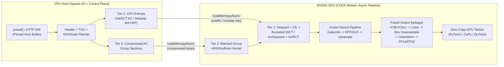

# Research & Implementation Plan: Porting `libjxl` Decoding to CUDA

## 1. Executive Summary & Goal

We audited the entire `libjxl` decode pipeline (~7,180 LOC across core decoding and render-pipeline stages) to determine **how much of JPEG XL decoding can be ported to CUDA**, which blocks map naturally to GPU parallelism, which blocks are fundamentally serial or branch-divergent, and how a CUDA backend composes with our experimental **ROI, power-of-two downscaling, and sparse `pread()` streaming** work.

> [!IMPORTANT]
> **Key Verdict:**
> - **~65–80% of VarDCT decode time** (Dequant + CfL + variable-size IDCT + Gaborish + EPF + Chroma/Frame Upsampling + XYB/YCbCr + Color/Transfer + Streaming Float Box Downsampling + FP16/FP32 packing) is **embarrassingly parallel** and ports cleanly to CUDA with **5×–20× kernel speedups** and **zero-copy output straight into GPU tensors (PyTorch / CuPy / DLPack)**.
> - **Entropy decoding (rANS / Huffman + LZ77)** is **strictly serial within each section**, but **100% independent across groups and frames**. For a single small ROI (1–4 groups), CPU entropy decode is faster than launching a tiny GPU kernel. For **full 8K frames (510 AC groups)** or **batched ML dataloaders (16–64 frames/ROIs)**, 500–2,000+ independent sections can saturate GPU SMs.
> - **Modular lossless MA-tree + Weighted Predictor (WP)** is the **hardest block for CUDA**: every pixel `(x, y)` depends serially on 4 causal neighbors (`W`, `N`, `NW`, `NE`), traverses a dynamic decision tree, and updates per-pixel WP error state. However, **Modular post-transforms (`InvSqueeze`/`PartialInvSqueeze`, `InvRCT`, `int_to_float` FP16 bit-unpacking) and the render pipeline** are massively parallel and trivial on CUDA.
> - **Current VM Note:** This remote VM has no `nvcc` / NVIDIA GPU (`which nvcc nvidia-smi` empty). All CUDA kernels and `JPEGXL_ENABLE_CUDA` CMake targets should be structured cleanly behind an experimental backend (`lib/jxl/cuda_experimental/`) with CPU-buildable stubs/tests here and full CUDA compilation + benchmarking on your NVIDIA GPU machine.

---

## 2. Stage-by-Stage CUDA Feasibility Matrix

Every stage in `libjxl`'s decode pipeline audited against its actual implementation:

| Decode Stage | Source File(s) | Parallelism Granularity | CUDA Suitability | Bottlenecks / Notes |
|---|---|---|---|---|
| **Container / Header / TOC / Range Planning** | [decode.cc](../lib/jxl/decode.cc), [dec_frame.cc](../lib/jxl/dec_frame.cc) | Control plane (tiny, `< 0.1 ms`) | **Stay on CPU** | Bit-level header parsing, sparse `pread()` range planning. |
| **DC Global / AC Global (Histograms, MA Tree, Matrices)** | [dec_frame.cc](../lib/jxl/dec_frame.cc), [dec_ans.cc](../lib/jxl/dec_ans.cc) | Small metadata (`< 1 ms`) | **Stay on CPU** | Build compact flat GPU lookup tables once per frame & upload. |
| **VarDCT AC Entropy (rANS / Huffman + LZ77)** | [dec_group.cc](../lib/jxl/dec_group.cc#L470-L540), [dec_ans.cc](../lib/jxl/dec_ans.cc) | **1 thread per AC group × pass** (510+ on 8K) | **Tier 2 (Batched / 8K)** | Serial within a group; great when `num_groups × batch >= 256`; LZ77 ring buffer needs careful L1/shared-mem budgeting. |
| **VarDCT Dequant + CfL + LLF Insert** | [dec_group.cc](../lib/jxl/dec_group.cc#L140-L181) | **Per-block / per-coeff** (500K+ blocks on 8K) | **Excellent (Tier 1)** | Pure SIMD math; fuse directly into IDCT input load. |
| **VarDCT Inverse DCT (27 `AcStrategy` sizes `8×8`..`256×256`)** | [dec_group.cc](../lib/jxl/dec_group.cc#L448), `dct-inl.h` | **Per-block** (warp/block cooperative) | **High (Tier 1)** | Heterogeneous block sizes cause warp divergence unless **bucketed by `AcStrategyType`** before launch. |
| **Modular MA-Tree + WP Entropy Decode** | [encoding.cc](../lib/jxl/modular/encoding/encoding.cc#L150-L350), [dec_ma.cc](../lib/jxl/modular/encoding/dec_ma.cc) | **1 thread per group** (causal pixel loop) | **Poor / Tier 3 Only** | Severe warp divergence on dynamic MA trees + `~64 KB` per-group WP line state; keep on CPU by default (fast-track `Gradient`-only / `Zero` groups in Tier 3). |
| **Modular `InvSqueeze` / `PartialInvSqueeze`** | [squeeze.cc](../lib/jxl/modular/transform/squeeze.cc#L334-L435) | **Per-row (H) / Per-col (V)** | **High (Tier 1)** | Classic 1D Haar + `SmoothTendency` stencil; trivially parallel per row/column at each pyramid level. |
| **Modular `InvRCT` & `int_to_float` (FP16/FP32)** | [dec_modular.cc](../lib/jxl/dec_modular.cc#L564-L738), `rct.cc` | **Per-pixel** (33M pixels on 8K) | **Excellent (Tier 1)** | 100% pointwise integer/bit-manipulation; fuses directly into render pipeline. |
| **Chroma Upsampling (4:2:0 / 4:2:2)** | [stage_chroma_upsampling.cc](../lib/jxl/render_pipeline/stage_chroma_upsampling.cc) | **Per-pixel** (1D 2-tap stencil) | **Excellent (Tier 1)** | Trivial shared-memory tiled 1D filter. |
| **Gaborish Inverse Filter** | [stage_gaborish.cc](../lib/jxl/render_pipeline/stage_gaborish.cc) | **Per-pixel** (3×3 stencil) | **Excellent (Tier 1)** | Single shared-memory tiled kernel; zero branching. |
| **EPF (Edge-Preserving Filter, 0/1/2 iters)** | [stage_epf.cc](../lib/jxl/render_pipeline/stage_epf.cc) | **Per-pixel** (5×5 / 3×3 stencils) | **Excellent (Tier 1)** | Highest CPU cost in VarDCT render pipeline (~30–40% of VarDCT render time!); massive GPU speedup. |
| **Frame Upsampling (2× / 4× / 8×)** | [stage_upsampling.cc](../lib/jxl/render_pipeline/stage_upsampling.cc) | **Per-pixel** (5×5 separable/non-sep kernel) | **Excellent (Tier 1)** | Constant-memory weight table + shared-memory tile. |
| **XYB → Linear RGB / YCbCr → RGB / Transfer / Tone-Map** | [stage_xyb.cc](../lib/jxl/render_pipeline/stage_xyb.cc), [stage_ycbcr.cc](../lib/jxl/render_pipeline/stage_ycbcr.cc), [stage_from_linear.cc](../lib/jxl/render_pipeline/stage_from_linear.cc) | **Per-pixel** (pure pointwise math) | **Excellent (Tier 1)** | Fuse into a **single epilogue kernel** with zero intermediate global memory traffic. |
| **Patches / Splines / Noise Synthesis** | `stage_patches.cc`, `stage_splines.cc`, `stage_noise.cc` | Sparse / low-frequency features | **Hybrid / Fallback** | Patches/splines are rare in VFX/ML; either simple scatter kernel or CPU fallback when `flags & (kPatches \| kSplines)`. |
| **Streaming Float Box Downsampling + Orientation + FP16/FP32 Output** | [stage_write.cc](../lib/jxl/render_pipeline/stage_write.cc) | **Per-output-pixel** | **Excellent (Tier 1)** | Directly replaces CPU mutex-striped `accum_main_` with lock-free GPU tile reduction writing straight into a `cudaMalloc` / PyTorch GPU tensor! |

---

## 3. Recommended Hybrid Architecture (3 Tiers)



### Tier 1 (Recommended First Milestone — Highest Value, Lowest Risk)
**Offload everything AFTER entropy decoding to CUDA:**
- **VarDCT**: Strategy-bucketed Dequant + CfL + IDCT (`8×8`, `16×16`, `32×32`, `16×8`, `8×16`, etc.) → Gaborish → EPF → Upsampling → Fused XYB/YCbCr + Color + Box Downsample + Orientation + FP16/FP32 write.
- **Modular**: `PartialInvSqueeze` / `InvSqueeze` → `InvRCT` → `int_to_float` (lossless FP16 bit-unpacking) → Fused Color + Box Downsample + Orientation + FP16/FP32 write.
- **Native VarDCT 1:8 DC (Path A)**: Upload tiny `dc_storage` (only `960×540×3` floats for 8K = 6 MB!) → Fused XYB + Color + Orientation + FP16/FP32 kernel directly into GPU tensor (`< 0.5 ms` on GPU!).
- **Why start here?**
  - Zero bitstream-divergence risk; 100% conformance with every JXL feature (arbitrary MA trees, LZ77, Huffman, ANS, multi-pass, containers).
  - Eliminates the heaviest VarDCT compute (IDCT + EPF + Gaborish + XYB) AND eliminates copying decoded 8K/2K pixels back and forth across PCIe.
  - Fits our existing `RenderPipeline` abstraction cleanly: implement a `CudaRenderPipeline` alongside `LowMemoryRenderPipeline`!

### Tier 2 (Full-8K & Batched-ML Throughput Milestone)
**Offload VarDCT AC Entropy Decoding (`DecodeACVarBlock` + rANS/Huffman) to CUDA:**
- Only compressed AC group sections cross PCIe (`~1–16 MB` instead of `~100+ MB` of quantized coefficients).
- **Parallelism strategy**: Launch 1 CUDA thread per `(frame, ac_group, pass)` — e.g., 510 threads for a single 8K frame, or `32 × 510 = 16,320` threads for a batch of 32 frames (or `64 × 4 = 256` threads for a batch of 64 512×512 ROIs).
- **LUT layout**: Flatten `ANSCode` alias tables (`log_alpha_size <= 12`, `4096` entries per histogram) and `context_map` into read-only device memory (`__ldg` / L2-resident).
- **Fallback rule**: If `uses_lz77 == true` (rare in VarDCT AC, common in Modular) or `num_required_groups < 32` (tiny single ROI), automatically keep entropy on CPU and run Tier 1 on GPU.

### Tier 3 (Conditional Research — High-Batch Lossless Modular FP16)
**Offload Fast-Track Modular Groups (`effort=1` / `Gradient`-only or `Zero` predictor) to CUDA:**
- General Modular MA-tree + WP (`4` weighted sub-predictors + dynamic tree branching + LZ77) is **not recommended for CUDA** because:
  1. Strict causal dependency `(x, y)` ← `(x-1, y), (x, y-1), (x-1, y-1), (x+1, y-1)` prevents intra-group pixel parallelism (even diagonal wavefronts have tiny width on `256×256` groups and cannot run in parallel with a single serial rANS bitstream!).
  2. Per-group WP state + `row_top` buffers require `~32–64 KB` per thread, crushing GPU occupancy.
- **Exception**: When encoding your own lossless 8K RGB HALF dataset with **fast Modular settings** (`Gradient` predictor only, single-leaf tree, no WP, no Squeeze — i.e., the exact fast-track already in [encoding.cc](../lib/jxl/modular/encoding/encoding.cc#L212-L265)), per-group state drops to `< 4 KB` (2 rows of `int32` in shared memory), making 1-thread-per-group GPU decoding viable across 510 groups or batched frames!

---

## 4. Integration with Experimental ROI, Downscaling & Sparse Streaming

Extend [decode_roi_experimental.h](../lib/include/jxl/decode_roi_experimental.h) (keeping `decode.h` 100% untouched) with an optional CUDA output target:

```c
// EXPERIMENTAL — only enabled when built with -DJPEGXL_ENABLE_CUDA=ON
typedef struct {
  void* device_ptr;        // Pre-allocated CUDA device buffer (e.g. torch.Tensor.data_ptr())
  size_t buffer_size;      // Size in bytes
  size_t row_stride_bytes; // Device pitch / row stride (0 = tightly packed)
  void* cuda_stream;       // cudaStream_t (NULL = default stream)
  int device_id;           // CUDA device ordinal
} JxlExperimentalCudaOutput;

JXL_EXPORT JxlDecoderStatus JxlDecoderExperimentalSetCudaOutputBuffer(
    JxlDecoder* dec, const JxlPixelFormat* format,
    const JxlExperimentalCudaOutput* cuda_out);
```

- **ROI + CUDA**: Only the required groups + halo are decoded and uploaded; GPU render pipeline computes only the ROI footprint (`unoriented_render_region`) and writes directly to `device_ptr` (e.g., a `(512, 512, 3)` `float16` PyTorch GPU tensor).
- **Downscaling + CUDA**:
  - Path A (1:8 DC) & Path B (Modular Squeeze) run native scaled pipelines on GPU.
  - Path C & Path D replace `WriteToOutputStage`'s mutex-locked CPU float accumulator with a **lock-free CUDA box-downsample epilogue kernel** reading directly from shared memory — completely eliminating the 1-ULP multithread ordering nondeterminism!
- **Sparse `pread()` + CUDA**: Caller reads only the required 0.8%–18% file bytes into pinned host memory (`cudaHostAlloc`), overlapping `pread()` of batch `N+1` with GPU decode of batch `N` on separate CUDA streams.

---

## 5. Proposed Changes (Phased File Layout)

### Phase 1: CMake Build Option & Experimental CUDA Interface (CPU-Testable Skeleton)
- **[MODIFY]** [CMakeLists.txt](../CMakeLists.txt) & [lib/jxl_lists.cmake](../lib/jxl_lists.cmake): Add `JPEGXL_ENABLE_CUDA` option (default `OFF`), optional `enable_language(CUDA)`, and `jxl_cuda_experimental` target.
- **[MODIFY]** [lib/include/jxl/decode_roi_experimental.h](../lib/include/jxl/decode_roi_experimental.h): Add `JxlExperimentalCudaOutput` and `JxlDecoderExperimentalSetCudaOutputBuffer` (returns `JXL_DEC_ERROR` cleanly when built without CUDA).

### Phase 2: Tier 1 — CUDA Render Pipeline + Modular Post-Transforms
- **[NEW]** `lib/jxl/cuda_experimental/cuda_context.{h,cc}`: Stream/pinned-staging/device-scratch allocator (reusable across `JxlDecoderRewind`/`Reset`).
- **[NEW]** `lib/jxl/cuda_experimental/cuda_render_pipeline.{h,cu}`:
  - `GaborishKernel` (3×3 shared-memory tile)
  - `EpfZeroKernel` / `EpfOneKernel` / `EpfTwoKernel` (tiled 5×5/3×3 stencils matching [stage_epf.cc](../lib/jxl/render_pipeline/stage_epf.cc))
  - `ChromaUpsampleKernel` & `FrameUpsampleKernel`
  - `FusedColorDownsampleWriteKernel` (XYB/YCbCr → Linear/sRGB → unclamped float box downsample → EXIF orientation → `FLOAT`/`FLOAT16`/`UINT8` directly into `device_ptr`)
- **[NEW]** `lib/jxl/cuda_experimental/cuda_modular_transforms.cu`: `InvHSqueezeKernel`, `InvVSqueezeKernel`, `InvRctKernel`, `IntToFloat16Kernel` (exact IEEE-754 bit-unpacking for lossless FP16).

### Phase 3: Tier 1B — Strategy-Bucketed VarDCT Dequant + IDCT on CUDA
- **[NEW]** `lib/jxl/cuda_experimental/cuda_vardct_idct.cu`:
  - Host/device bucketing of blocks by `AcStrategyType`.
  - Specialized warp/shared-memory kernels for common strategies (`DCT8X8`, `DCT16X16`, `DCT32X32`, `DCT16X8`, `DCT8X16`, `IDENTITY`, `DCT2X2`, `DCT4X4`, `AFV0..3`), with a generic separable radix-2/4 fallback for `64×64`..`256×256`.

### Phase 4: Tier 2 — Batched VarDCT AC Entropy Decoder on CUDA
- **[NEW]** `lib/jxl/cuda_experimental/cuda_ans_ac.cu`:
  - Flat GPU histogram + context-map uploader.
  - 1-thread-per-group rANS/Huffman AC decoder writing directly into device coefficient buffers.
  - Automatic CPU fallback for `uses_lz77` or small single-ROI group counts (`< 32` groups).

---

## 6. Verification Plan

1. **CPU-vs-GPU Numerical Parity Suite (`lib/jxl/cuda_experimental/decode_cuda_test.cc`)**:
   - **Lossless Modular FP16 (all 65,536 half patterns + 2K/8K ROI)**: **0-bit difference** (`memcmp == 0` after D2H copy) vs. CPU `libjxl`.
   - **VarDCT (Full, ROI, 1:8 DC, 1:4 Progressive, 1:4 Reference Resample, all 8 orientations)**: `max_abs_err < 1e-4` (`FLOAT`) and `< 2e-3` (`FLOAT16`) vs. CPU `libjxl` (matching Highway SIMD FMA rounding).
   - **Combined Sparse `pread()` + CUDA**: Bit-exact parity between sequential CPU, sparse CPU, and sparse CUDA on Full, ROI, Scaled, and Scaled-ROI.
2. **Performance & Utilization Benchmarks (on target NVIDIA GPU)**:
   - Measure single-frame 8K RGB HALF (Full, 512×512 ROI, 2K 1:4, 1K 1:8) AND batched throughput (batch size 1, 8, 32, 64) comparing:
     - CPU `libjxl` (multi-threaded) + `cudaMemcpy` H2D
     - Tier 1 Hybrid (CPU entropy → GPU IDCT + Render Pipeline → GPU Tensor)
     - Tier 2 (GPU batched VarDCT AC entropy + IDCT + Render Pipeline → GPU Tensor)
   - Track end-to-end patches/sec, PCIe bytes transferred, CPU utilization %, GPU SM occupancy, and peak host/device RAM.

---

## 7. Open Questions Before Starting Implementation

1. **Primary Codec Mode for Your Dataset**: Are your 8K RGB HALF frames encoded predominantly as **lossless Modular** (for bit-exact FP16) or **lossy VarDCT** (e.g. `distance = 0.5`)?
   - *Why it matters:* VarDCT gets the biggest immediate speedup from **Tier 1 (GPU IDCT + EPF + Gaborish + XYB)** + **Tier 2 (GPU AC rANS)**, whereas lossless Modular gets its biggest speedup from **ROI sparse `pread()` + Tier 1 (`InvRCT` + `int_to_float` + GPU box downsample)** and optionally **Tier 3 fast-track `Gradient`-only Modular** if you control the encoder settings.
2. **Target GPU & Build Environment**: Since this remote VM is CPU-only (no `nvcc`), would you like us to:
   - **(Recommended)** Implement **Phase 1 + Phase 2 (Tier 1 CUDA kernels + CMake `JPEGXL_ENABLE_CUDA` + CPU fallback + unit tests)** in the repo so you can compile and benchmark directly on your CUDA machine, **or**
   - Keep this as an architectural research/design doc (`doc/cuda_decode_plan.md`) first while you decide between `libjxl` CUDA vs. OpenEXR/HTJ2K?
3. **Batch vs. Single-Frame Priority**: Is your main goal **batched ML training throughput** (e.g. 32–64 512×512 crops or 2K frames per step into PyTorch GPU tensors) or **single-frame interactive latency**?
