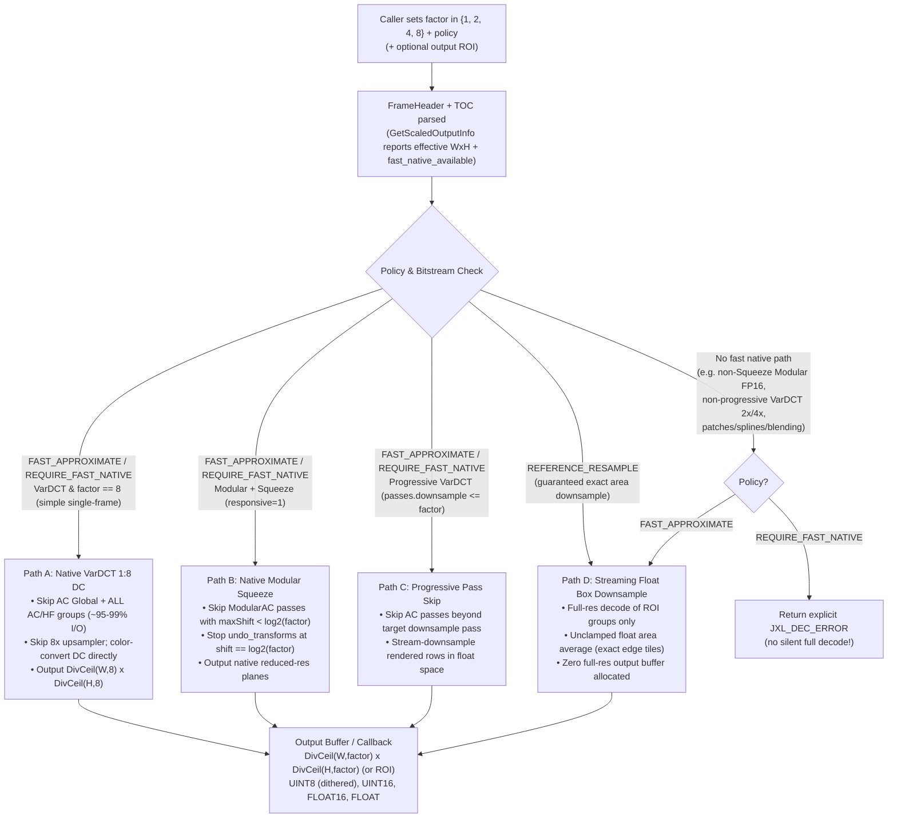

# Experimental Power-of-Two Reduced-Resolution (Downscaled) Decoding for `libjxl`

## Goal Description

Extend our experimental decoder interface ([decode_roi_experimental.h](../lib/include/jxl/decode_roi_experimental.h), keeping [decode.h](../lib/include/jxl/decode.h) 100% untouched) to support **power-of-two reduced-resolution decoding** (`factor ∈ {1, 2, 4, 8}` — e.g., decoding an 8K 7680×4320 image directly at 4K, 2K 1920×1080, or 1K 960×540), composable with our existing **ROI selection**, **TOC byte-range planning**, **sparse offset-tagged input**, and **sequential push streaming**.

This design directly incorporates upstream maintainer discussions and constraints:
- **#668 (deymo)**: Fixed power-of-two scale-down (`1, 2, 4, 8`) belongs in the low-level decoder so it can skip unneeded entropy passes, transforms, and output memory; arbitrary non-power-of-two scaling is out of scope.
- **#4297 (Jon Sneyers & jonnyawsom3)** & **#1379** & **PR #4699**:
  - Unlike `djxl -s 2|4|8` (which stops progressive decoding via `JxlDecoderGetIntendedDownsamplingRatio` + `JxlDecoderFlushImage` and upsamples back to full resolution, and does not work for Modular Squeeze), the decoder must emit **true reduced-resolution output buffers** of size `DivCeil(W, factor) × DivCeil(H, factor)` (e.g., 12.44 MB instead of 199.07 MB for 8K→2K RGB HALF) while keeping `JxlDecoderGetBasicInfo` reporting the original full-image dimensions for full backward compatibility.
  - **Never silently conflate approximate native decode with exact reference resizing**: expose an explicit **exactness policy** (`FAST_APPROXIMATE`, `REQUIRE_FAST_NATIVE`, `REFERENCE_RESAMPLE`) and capability introspection (`GetScaledOutputInfo`) so applications and ML training pipelines know *before* allocating buffers or fetching byte ranges whether a fast native path exists or whether a defined linear float area-downsample fallback will run.
- **#1621, #1623, #1133, #4328, #3989/#3991**: Reuse the exact same TOC byte-range planner and sparse offset-tagged input built for ROI so scale + ROI compose cleanly over both sequential streams and seekable NAS / HTTP Range storage, measuring actual bytes read rather than assuming contiguous file-percentage prefixes.
- **#603 & #4787**: Preserve existing `JXL_DEC_FRAME_PROGRESSION` and `JXL_DEC_FULL_IMAGE` event semantics; keep standalone embedded preview frames orthogonal.
- **#3881 & Scene-Linear HDR FP16/FP32 Fidelity**: Never silently insert sRGB conversion, tone mapping, or `[0, 1]` clamping. Downsample in unclamped 32-bit float space preserving negative values, bright linear highlights (`> 1.0`), subnormals, and `-0.0` with exact border-tile weighting.
- **Rust (`jxl-rs` #857, #387, #933, PR #1052, PR #1080, PR #1028)**: Informative precedent (approximate downsampled rendering and ROI coordinate conventions), while keeping C++ ABI isolated in `decode_roi_experimental.h` pending upstream #4297/#1621/#3519 sign-off.

---

## Architecture, Policies & Decoding Paths



### Detailed Mechanics of Each Path

#### Path A: Native VarDCT 1:8 DC (`factor == 8`)
- **Eligibility**: `frame_header.encoding == FrameEncoding::kVarDCT`, `factor == 8`, `frame_header.upsampling == 1`, `!frame_header.CanBeReferenced()`, `frame_header.dc_level == 0`, no `kPatches`/`kSplines`/`kNoise`, no `NeedsBlending`, and no extra channels (or extra channels also support 1:8).
- **I/O & Compute Savings**:
  - `PlanRequiredGroups()` skips **AC Global** and **all AC/HF groups** (`required_sections = 1 + num_dc_groups`, ~1–2% of the file!).
  - `GetRequiredInputRanges()` returns ONLY the file byte ranges for DC Global + DC Groups!
  - In `FinalizeFrame()`, instead of running `upsampler8x`, we run the color pipeline (`XYB` / `YCbCr` → linear → tone-map / CMS → `WriteToOutputStage`) **directly on `shared_storage.dc_storage`** (`xsize_blocks × ysize_blocks` = `DivCeil(W, 8) × DivCeil(H, 8)`), clipped to any active scaled ROI, honoring all 8 EXIF orientations and float/HALF/integer output formats!

#### Path B: Native Modular Squeeze Partial Inverse (`factor ∈ {2, 4, 8}`)
- **Eligibility**: `frame_header.encoding == FrameEncoding::kModular`, `factor ∈ {2, 4, 8}`, `!frame_header.CanBeReferenced()`, no `NeedsBlending`, and `full_image` has global `kSqueeze` transforms reaching `min(hshift, vshift) >= log2(factor)` on all non-meta channels (standard `responsive = 1` progressive Modular!).
- **I/O & Compute Savings**:
  - Let `target_shift = CeilLog2Nonzero(factor)` (`1`, `2`, or `3`).
  - Using `frame_header.passes.GetDownsamplingBracket(p, minShift, maxShift)` (from PR #1406), any Modular AC pass with `maxShift < target_shift` is **completely skipped** in `PlanRequiredGroups()`, `GetRequiredInputRanges()`, sparse input, and `ProcessSections()`!
  - In `ModularFrameDecoder::FinalizeDecoding()`, `undo_transforms` stops undoing `kSqueeze` steps whose output shift would drop below `target_shift` (undoing any `kRCT`/`kPalette` and coarser `kSqueeze` steps only).
  - The resulting `full_image` channels are natively `DivCeil(W, factor) × DivCeil(H, factor)` and are converted + written directly at scaled dimensions!

#### Path C: Progressive VarDCT Pass Skipping (`factor ∈ {2, 4}`)
- **Eligibility**: `frame_header.encoding == FrameEncoding::kVarDCT`, `frame_header.passes.num_passes > 1`, and there exists `k < num_passes` such that `frame_header.passes.GetDownsamplingTargetForCompletedPasses(k) <= factor`.
- **I/O & Compute Savings**:
  - `PlanRequiredGroups()` caps required passes per AC group to `required_passes_ = k`.
  - `GetRequiredInputRanges()` omits all sections for passes `>= k`!
  - Decoded groups run through the streaming float box downsampler (Path D) to emit `DivCeil(W, factor) × DivCeil(H, factor)` output.

#### Path D: Low-Memory Streaming Float Box Downsample (`REFERENCE_RESAMPLE` or Fallback)
- **When used**: Explicitly requested via `JXL_EXP_SCALE_REFERENCE_RESAMPLE`, OR fallback under `JXL_EXP_SCALE_FAST_APPROXIMATE` when the bitstream has no native low-res path (most notably **lossless Modular FP16 without Squeeze**, non-progressive VarDCT at `factor == 2, 4`, or frames with patches/splines/blending/references).
- **How it works (zero full-resolution output allocation, exact scene-linear float math)**:
  - Inside `WriteToOutputStage` (with `FastXYBStage` disabled when `factor > 1`), allocate only a compact **downsampled float accumulator** of size `scaled_region_w × scaled_region_h × num_channels` (plus optional extra channels), synchronized with row-striped mutexes so multithreaded `LowMemoryRenderPipeline` is race-free.
  - Accumulate incoming unoriented rows intersecting `unoriented_region_` in **unclamped 32-bit `float` space** (preserving negative values, bright linear HDR values `> 1.0`, and subnormals; never inserting sRGB conversion or tone mapping).
  - In `FinalizeOutput()` (called from `FrameDecoder::FinalizeFrame()`): divide each accumulated pixel by its exact `tile_w * tile_h` count (exact edge-tile weighting for odd/non-divisible dimensions!), apply `flip_y_`, `flip_x_`, `unpremul_alpha_`, `StoreUnsignedRow` (with 8-bit `kDither` on downsampled coords) / `StoreFloat16Row` / `StoreFloatRow`, and `WriteToOutput` (supporting buffers, callbacks, and all 8 EXIF orientations).
  - Still composes with ROI skipping: maps scaled ROI `[sx0, sx0+sw) × [sy0, sy0+sh)` to full-res `[sx0*s, min(W, (sx0+sw)*s)) × [sy0*s, min(H, (sy0+sh)*s))` and skips all AC groups outside that full-res rect + halo!

---

## Experimental C API Additions ([decode_roi_experimental.h](../lib/include/jxl/decode_roi_experimental.h))

Keeping [decode.h](../lib/include/jxl/decode.h) **100% untouched**:

```c
/**
 * Exactness / fallback policy for reduced-resolution decoding.
 */
typedef enum {
  /** Use fastest native codec path (VarDCT 1:8 DC, Modular Squeeze, progressive
   * pass skip), falling back to streaming float box downsample if unavailable. */
  JXL_EXP_SCALE_FAST_APPROXIMATE = 0,
  /** Require a fast native path that avoids full-resolution decode; return
   * JXL_DEC_ERROR if the frame/bitstream has no native low-res representation. */
  JXL_EXP_SCALE_REQUIRE_FAST_NATIVE = 1,
  /** Always decode full-resolution pixels (within any active ROI) and apply the
   * defined unclamped float box/area downsample (reference-accurate for ML). */
  JXL_EXP_SCALE_REFERENCE_RESAMPLE = 2,
} JxlExperimentalScalePolicy;

/**
 * Reports which reduced-resolution decode strategy was selected for the frame.
 */
typedef enum {
  JXL_EXP_SCALE_MODE_NONE = 0,
  JXL_EXP_SCALE_MODE_NATIVE_VARDCT_DC = 1,
  JXL_EXP_SCALE_MODE_MODULAR_SQUEEZE_NATIVE = 2,
  JXL_EXP_SCALE_MODE_PROGRESSIVE_PASS_SKIP = 3,
  JXL_EXP_SCALE_MODE_STREAMING_DOWNSAMPLE_FALLBACK = 4,
} JxlExperimentalScaleDecodeMode;

/**
 * Sets power-of-two output downsampling factor (1, 2, 4, or 8) and exactness
 * policy. Effective canvas becomes DivCeil(W, factor) x DivCeil(H, factor).
 * JxlDecoderGetBasicInfo continues to report original full-image dimensions.
 */
JXL_EXPORT JxlDecoderStatus JxlDecoderExperimentalSetOutputDownsampling(
    JxlDecoder* dec, uint32_t factor, JxlExperimentalScalePolicy policy);

/**
 * Queries effective output dimensions (accounting for orientation,
 * downsampling, and any active output region) and whether a fast native path
 * is available for the current frame.
 */
JXL_EXPORT JxlDecoderStatus JxlDecoderExperimentalGetScaledOutputInfo(
    const JxlDecoder* dec, uint32_t* width, uint32_t* height,
    JXL_BOOL* fast_native_available,
    JxlExperimentalScaleDecodeMode* scale_mode);
```

And extend `JxlExperimentalRegionDecodeStats` with:
- `uint32_t downsampling;`
- `JxlExperimentalScalePolicy scale_policy;`
- `JxlExperimentalScaleDecodeMode scale_mode;`
- `size_t total_passes;`
- `size_t required_passes;`

---

## Finalized Design Decisions

> [!IMPORTANT]
> 1. **ROI + Downsampling Coordinates**: When both `JxlDecoderExperimentalSetOutputDownsampling(factor, policy)` and `JxlDecoderExperimentalSetOutputRegion(x, y, w, h)` are active, `(x, y, w, h)` are specified in **downsampled output coordinates** `[0, DivCeil(W, factor)) × [0, DivCeil(H, factor))`, matching the output buffer dimensions and `JxlDecoderImageOutBufferSize`.
> 2. **Implementation Scope**: Implement **all 4 decode paths** (Path A: Native VarDCT 1:8 DC, Path B: Native Modular Squeeze partial inverse, Path C: Progressive VarDCT pass skipping, Path D: Streaming float box downsample) and **all 3 exactness policies** (`FAST_APPROXIMATE`, `REQUIRE_FAST_NATIVE`, `REFERENCE_RESAMPLE`) in this pass.

---

## Proposed Changes

### 1. Experimental Header
#### [MODIFY] [decode_roi_experimental.h](../lib/include/jxl/decode_roi_experimental.h)
- Add `JxlExperimentalScalePolicy`, `JxlExperimentalScaleDecodeMode`, extended `JxlExperimentalRegionDecodeStats` fields, `JxlDecoderExperimentalSetOutputDownsampling`, and `JxlDecoderExperimentalGetScaledOutputInfo`.

### 2. Streaming Float Box Downsampling Output Stage
#### [MODIFY] [stage_write.h](../lib/jxl/render_pipeline/stage_write.h) & [stage_write.cc](../lib/jxl/render_pipeline/stage_write.cc)
- Add `size_t downsampling = 1` support and `FinalizeOutput()` hook on `WriteToOutputStage` / `RenderPipeline`.
- Accumulate unoriented rows in unclamped 32-bit float space into a compact `scaled_region_w × scaled_region_h` buffer with row-striped locking; divide by exact `tile_w * tile_h` in `FinalizeOutput()`, then apply orientation, unpremul alpha, `kDither`/format conversion, and buffer/callback output.

### 3. Native Fast Paths (VarDCT 1:8 DC, Modular Squeeze, Progressive Pass Skip)
#### [MODIFY] [dec_modular.h](../lib/jxl/dec_modular.h) & [dec_modular.cc](../lib/jxl/dec_modular.cc)
- Add `CanDecodeAtDownsampling(size_t downsampling) const` and partial `kSqueeze` inverse in `FinalizeDecoding(...)` stopping at `target_shift = CeilLog2Nonzero(downsampling)`, outputting native reduced-resolution planes.

#### [MODIFY] [dec_cache.h](../lib/jxl/dec_cache.h) & [dec_cache.cc](../lib/jxl/dec_cache.cc)
- Add `size_t output_downsampling = 1` and `bool native_dc_8x = false` to `PassesDecoderState`; disable `fast_xyb_srgb8_conversion` when `output_downsampling > 1`; support lightweight 1:8 DC color+output pipeline when `native_dc_8x` is active.

#### [MODIFY] [dec_frame.h](../lib/jxl/dec_frame.h) & [dec_frame.cc](../lib/jxl/dec_frame.cc)
- Add `ScalePolicy`, `ScaleDecodeMode`, `SetOutputDownsampling(size_t factor, ScalePolicy policy)`, and `IsFastNativeScaleAvailable() const`.
- Update `PlanRequiredGroups`, `IsSectionRequiredPlanned`, `GetRequiredCodestreamRanges`, `ProcessSections`, and `FinalizeFrame` to select Paths A/B/C/D according to `policy` (returning error under `kRequireFastNative` when no native path exists), skip AC Global + AC groups for Path A, skip unneeded passes for Paths B & C, and run `FinalizeOutput()` / native DC render in `FinalizeFrame()`.

### 4. Decoder State Machine & Introspection
#### [MODIFY] [decode.cc](../lib/jxl/decode.cc)
- Add `output_downsampling` (default `1`) and `scale_policy` to `JxlDecoder` (reset in `JxlDecoderReset`, preserved across `JxlDecoderRewind`).
- Implement `JxlDecoderExperimentalSetOutputDownsampling` and `JxlDecoderExperimentalGetScaledOutputInfo`.
- Update `ValidateDecodeRegionBounds`, `GetMinSize`, and `PopulateRegionStats` to respect effective scaled dimensions and report `downsampling`, `scale_policy`, `scale_mode`, `total_passes`, and `required_passes`.

---

## Verification Plan

### New Test Suite ([decode_scale_test.cc](../lib/jxl/decode_scale_test.cc), registered in [jxl_lists.cmake](../lib/jxl_lists.cmake))

1. **Adversarial Non-Squeeze Lossless Modular FP16 & HDR Float Fidelity**:
   - Test linear HDR images containing negative values (`-0.25`), subnormals, `-0.0`, and highlights (`> 1.0`, up to `8.0`) in both `JXL_TYPE_FLOAT` and `JXL_TYPE_FLOAT16`.
   - Verify `JXL_EXP_SCALE_REQUIRE_FAST_NATIVE` returns `JXL_DEC_ERROR` and `GetScaledOutputInfo` reports `fast_native_available == JXL_FALSE` on non-Squeeze Modular!
   - Verify `JXL_EXP_SCALE_REFERENCE_RESAMPLE` (and `FAST_APPROXIMATE` fallback) has **zero clamping**, zero NaN/Inf on finite inputs, and matches a double-precision reference area downsample of the full-res float decode to **`max_abs_err < 1e-5` (`FLOAT`)** and **`<= 1 ULP` (`FLOAT16`)**!
2. **Native Fast-Path Closeness & I/O Reduction**:
   - **VarDCT 1:8 DC (`factor == 8`)**: Verify `scale_mode == JXL_EXP_SCALE_MODE_NATIVE_VARDCT_DC`, `fast_native_available == JXL_TRUE`, `required_groups == 0`, sparse bytes read `< 5%` of a 2K VarDCT file, and high fidelity (`PSNR > 30 dB`, `MAE < 0.02`, exact spatial alignment via ±1 px shift check) against reference 8× downsampled full decode.
   - **Modular Squeeze (`responsive = 1`, `factor = 2, 4, 8`)**: Verify `scale_mode == JXL_EXP_SCALE_MODE_MODULAR_SQUEEZE_NATIVE`, `required_passes < total_passes`, sparse bytes read reduced, and `PSNR > 32 dB` + exact spatial alignment!
   - **Progressive VarDCT (`progressive_ac = 1`, `factor = 2, 4`)**: Verify `scale_mode == JXL_EXP_SCALE_MODE_PROGRESSIVE_PASS_SKIP`, `required_passes < total_passes`, sparse bytes read reduced, and `PSNR > 34 dB`!
   - **Policy Enforcement**: Verify `JXL_EXP_SCALE_REFERENCE_RESAMPLE` forces `JXL_EXP_SCALE_MODE_STREAMING_DOWNSAMPLE_FALLBACK` even on VarDCT 1:8 and Modular Squeeze, matching exact reference box downsample!
3. **Odd Dimensions, All 8 EXIF Orientations & Output Modes**:
   - Non-divisible dimensions (e.g., `517 × 389` at `factor = 2, 4, 8`) verifying exact border-tile averaging (no dark right/bottom edge).
   - All 8 EXIF orientations (`keep_orientation = false/true`) in `UINT8`, `FLOAT16`, and `FLOAT`.
   - Buffer + simple callback + multithreaded callback + alpha/extra channels.
4. **Combined ROI + Downsampling + Sparse Random-Access**:
   - Decode a scaled crop `(x, y, w, h)` at `factor = 2, 4, 8` via sparse `GetRequiredInputRanges()` + `SetInputAtOffset()`, verifying **0-diff bit-exact** equality against extracting `(x, y, w, h)` from the downscaled full image!
   - Fast **2K RGB HALF (`2048×1080 → 512×270` at 4×)** test in the main run, plus on-demand **`DISABLED_Float8kTo2kScaleBenchmark`** (`7680×4320 → 1920×1080` at 4× and `960×540` at 8×).

### Automated Verification Commands
```bash
ninja -C build decode_scale_test decode_region_test decode_test render_pipeline_test
./build/lib/tests/decode_scale_test
./build/lib/tests/decode_region_test
./build/lib/tests/render_pipeline_test
./build/lib/tests/decode_test
```
