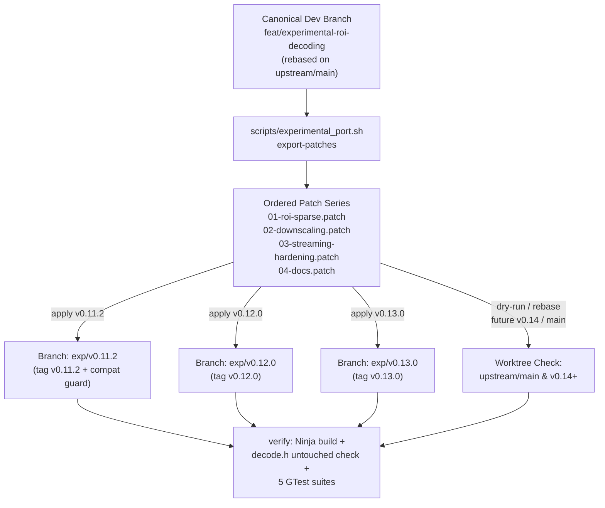

# Implementation Plan: Multi-Version Backporting (`v0.11.1`, `v0.11.2`, `v0.12.0`, `v0.13.0`) & Upstream Forward-Porting System

## 1. Goal Description

Port our three experimental `libjxl` features (**ROI decoding + sparse byte-range I/O**, **power-of-two downscaled decoding**, and **unified 4×2 streaming decoding**, plus all plans, walkthroughs, and unit test suites) onto dedicated fork branches anchored at exact upstream release tags—**`v0.11.1`** (current production build), **`v0.11.2`**, **`v0.12.0`**, and **`v0.13.0`**—and establish a **repeatable patch-isolation, backporting, and forward-porting workflow** so future upstream releases (`v0.14.x`, `v0.15.x`, and `upstream/main`) can be synced, conflict-checked, and verified cleanly.

---

## 2. Pre-Flight Compatibility Audit (Verified Against Upstream Tags)

We queried `https://github.com/libjxl/libjxl.git` and audited our **29 touched files** (10 brand-new zero-conflict files + 19 modified files; [decode.h](../lib/include/jxl/decode.h) remains **100% untouched**) against the exact upstream release tags:

| Release Line | Target Tag | Commit SHA | Upstream Drift on Our 19 Modified Files | Expected Backport Effort |
|---|---|---|---|---|
| **0.13** | **`v0.13.0`** | `5a7da834` | **0 files changed** between `v0.13.0` and our base (`12e4bf4`) | **Zero-conflict clean apply** |
| **0.12** | **`v0.12.0`** | `a7a9c787` | 7 files with minor context diffs (`dec_cache.cc`, `dec_frame.cc`, `decode.cc`, `squeeze.cc`, `low_memory_render_pipeline.{h,cc}`, `jxl_lists.cmake`); `jxlp_ooo_buffer` and `JXL_ENC_FRAME_SETTING_OUTPUT_MODE` both exist | **Low** (`git am --3way` + minor context adjustments) |
| **0.11 (latest)** | **`v0.11.2`** | `332feb17` | `testing.h`, `UsesFullImage()`, `file_pos`, `box_contents_end`, `CanAddBuffer`, `JXL_ENSURE` all exist; **missing** `jxlp_ooo_buffer` in `decode.cc` and `JXL_ENC_FRAME_SETTING_OUTPUT_MODE` in `encode.h` | **Medium** (2 small version-compat guards + hunk context alignment) |
| **0.11 (prod one-off)** | **`v0.11.1`** | `794a5dcf` | Same 0.11.x baseline as `v0.11.2` (tiny patch delta between `v0.11.1` and `v0.11.2`) | **Low** (reuses `v0.11.2` adapted patch series directly) |
| **Future (`0.14+` / `main`)** | `upstream/main` | rolling | Unknown future refactors in `decode.cc` / `dec_frame.cc` / `low_memory_render_pipeline.cc` | **Automated dry-run detection** via `scripts/experimental_port.sh` |

> [!IMPORTANT]
> **Key Architectural Property That Makes Multi-Version Porting Practical:**
> - **10 of 29 files are 100% self-contained new files** (`decode_roi_experimental.h`, `decode_region_test.cc`, `decode_scale_test.cc`, `decode_streaming_test.cc`, and 6 `doc/` files) — zero merge conflicts on any version.
> - **Public `lib/include/jxl/decode.h` has 0 lines modified** — zero ABI conflicts across `0.11` → `0.15+`.
> - Only **`decode.cc`**, **`dec_frame.{h,cc}`**, **`dec_cache.{h,cc}`**, **`dec_modular.{h,cc}`**, **`squeeze.{h,cc}`**, and **`render_pipeline/`** touch upstream code, and all experimental hooks are clearly isolated.

---

## 3. Architecture of the Isolation & Multi-Version Porting System

### Design Rules for Long-Term Maintainability (`0.11` → `0.15+`)
1. **Single Source of Truth on `feat/experimental-roi-decoding`**:
   - New features or bugfixes land on `feat/experimental-roi-decoding` first, then are ported to release branches (`exp/v0.13.0`, `exp/v0.12.0`, `exp/v0.11.2`) via `scripts/experimental_port.sh` or `git cherry-pick`.
2. **Version-Agnostic Compatibility Guards (Minimal & Explicit)**:
   - In `lib/jxl/decode_streaming_test.cc`: guard `JXL_ENC_FRAME_SETTING_OUTPUT_MODE` test block with a compile-time version/feature check (e.g. `JPEGXL_NUMERIC_VERSION >= JPEGXL_COMPUTE_NUMERIC_VERSION(0, 12, 0)`), so the exact same test file builds and runs on `v0.11.2`, `v0.12.0`, `v0.13.0`, and `v0.14+` with zero manual edits!
   - In `lib/jxl/decode.cc` (for `v0.11.2` only): drop the `dec->jxlp_ooo_buffer.empty()` clause since `v0.11.2` only supports in-order `jxlp` boxes anyway (out-of-order `jxlp` was added in `v0.12`).
3. **Isolated Build Directories Per Branch (Zero Rebuild Thrash)**:
   - Use `git worktree` (or separate `build-v0.11.2`, `build-v0.12.0`, `build-v0.13.0` directories) during verification so switching between release branches never clobbers `build/` or submodules.

---

## 4. Proposed Changes

### Component 1: Automated Porting & Verification Script
#### [NEW] `scripts/experimental_port.sh`
A self-contained POSIX/Bash tool committed to our branch supporting four subcommands:
- `scripts/experimental_port.sh export-patches <base_ref> <out_dir>`
  - Exports clean `git format-patch` files from `<base_ref>..HEAD` (default base: merge-base with `upstream/main` or `12e4bf4`).
- `scripts/experimental_port.sh port <target_ref> <new_branch> [patch_dir]`
  - Fetches `<target_ref>` from `upstream` if not present locally, creates `<new_branch>` at `<target_ref>` in a clean worktree (or checkout), and runs `git am --3way` on the patch series.
  - Reports exact conflicting files/hunks if upstream changed around a hook, leaving the worktree ready for resolution.
- `scripts/experimental_port.sh verify [build_dir]`
  - Verifies `git diff --stat <base> -- lib/include/jxl/decode.h` is **empty** (ABI guard).
  - Builds `decode_region_test`, `decode_scale_test`, `decode_streaming_test`, `render_pipeline_test`, and `decode_test` with Ninja.
  - Runs all 5 test binaries and prints a compact pass/fail summary table.
- `scripts/experimental_port.sh check-upstream [target_ref]`
  - Creates a temporary detached `git worktree` at `upstream/main` (or any future tag like `v0.14.0`), attempts `git am --3way` of our patch stack, optionally builds & runs the 3 experimental test suites, and cleans up the worktree — giving an instant green/red forward-port health check without modifying any local branch!

---

### Component 2: Version-Agnostic Test Guard
#### [MODIFY] [lib/jxl/decode_streaming_test.cc](../lib/jxl/decode_streaming_test.cc)
- Guard the `JXL_ENC_FRAME_SETTING_OUTPUT_MODE` loop in `ContainerLayoutsAndEncoderOutputModes` with `#if JPEGXL_NUMERIC_VERSION >= JPEGXL_COMPUTE_NUMERIC_VERSION(0, 12, 0)` (falling back to testing raw + `jxlc` + multi-`jxlp` on `v0.11.2`), so the exact same test file compiles cleanly on `v0.11.2`, `v0.12.0`, `v0.13.0`, and `v0.14+`.

---

### Component 3: Release Checkpoint Branches on Fork (`davisadam10/libjxl`)
1. **Fetch upstream tags** (`v0.11.1`, `v0.11.2`, `v0.12.0`, `v0.13.0`) into our local git repository (adding read-only `upstream` remote `https://github.com/libjxl/libjxl.git`).
2. **Branch 1 — `exp/v0.13.0`** (anchored at exact tag `v0.13.0`, `5a7da834`):
   - Apply patch stack cleanly onto `v0.13.0`, build, verify all 5 test suites pass, push to `origin`.
3. **Branch 2 — `exp/v0.12.0`** (anchored at exact tag `v0.12.0`, `a7a9c787`):
   - Apply patch stack via `git am --3way` onto `v0.12.0`, resolve any minor context diffs in the 7 touched files, build, verify all 5 test suites pass, push to `origin`.
4. **Branch 3 — `exp/v0.11.2`** (anchored at exact tag `v0.11.2`, `332feb17`):
   - Apply patch stack via `git am --3way` onto `v0.11.2`, adapt `decode.cc` (`jxlp_ooo_buffer` not present in 0.11) and any minor 0.11 API/context diffs, build, verify all 5 test suites pass, push to `origin`.
5. **Branch 4 — `exp/v0.11.1`** (one-off production build anchored at exact tag `v0.11.1`, `794a5dcf`):
   - Apply the verified `v0.11.2` patch series onto `v0.11.1`, build, verify all 5 test suites pass, push to `origin`.

---

## 5. Verification Plan

For **every** release branch (`exp/v0.13.0`, `exp/v0.12.0`, `exp/v0.11.2`, `exp/v0.11.1`) and `feat/experimental-roi-decoding`:
1. Confirm `git diff --stat <release_tag> -- lib/include/jxl/decode.h` is **empty**.
2. Build and run all 5 test suites via `scripts/experimental_port.sh verify`:
   - `decode_region_test` (11/11)
   - `decode_scale_test` (10/10)
   - `decode_streaming_test` (7/7)
   - `render_pipeline_test`
   - `decode_test`
3. Verify `scripts/experimental_port.sh check-upstream v0.13.0` passes end-to-end as a smoke test of the forward-porting automation.
4. Commit `doc/multi_version_porting_plan.md` and `doc/multi_version_porting_walkthrough.md` with the exact per-branch commit SHAs, conflict notes, and test results.

---

## 6. Finalized Decisions

1. **Branch naming convention (Confirmed)**: Short names — **`exp/v0.11.1`** (current production one-off), **`exp/v0.11.2`**, **`exp/v0.12.0`**, **`exp/v0.13.0`** (matching future `exp/v0.14.0`, `exp/v0.15.0`, etc.).
2. **Release checkpoints (Confirmed)**: Match exact upstream release tags (**`v0.11.1`**, **`v0.11.2`**, **`v0.12.0`**, **`v0.13.0`**) for parity; future patch releases will get their own version branch (e.g., `exp/v0.12.1`).
3. **Automation scope (Confirmed)**: Local **`scripts/experimental_port.sh`** CLI only — no GitHub Actions workflow at this point.
