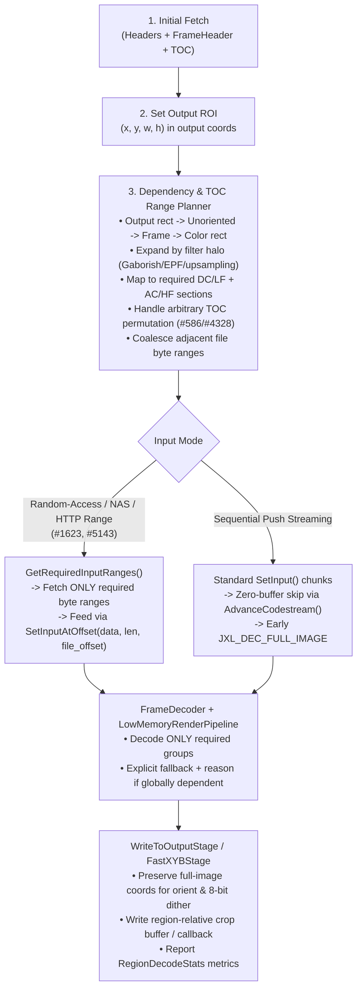

# Upstream-Aligned ROI, TOC Range Planning & Sparse-Input Decoding for `libjxl`

## Goal Description

Implement true minimal-I/O, minimal-CPU, minimal-RAM **region-of-interest (ROI) & random-access decoding** in `libjxl`—targeting 256–1024 px crops from very large JPEG XL images (including **8K 7680×4320 ACES2065-1 RGB HALF** frames on NAS/object storage)—aligned closely with upstream maintainer discussions:

- **#1623** (Jon Sneyers): Crop target + discover required compressed byte ranges from headers/TOC + support sparse/discontinuous input with holes outside the crop.
- **#1294** (Jon Sneyers): Separate requested `output_rect` from internal `dependency_rect` (filter halo for Gaborish/EPF/upsampling/chroma, LF/DC, references), matching full-decode-then-crop pixels with explicit fallback when not guaranteed.
- **#3519** (Jon Sneyers): **Do not lock down unqualified public `JxlDecoder*` ABI symbols** in `lib/include/jxl/decode.h` before upstream consensus; build internal primitives first and expose a small, explicitly experimental extension header for fork/testing use.
- **#668** (deymo / Jon Sneyers): Place ROI primitives in the low-level decoder core (not a full-decode-and-crop wrapper); keep power-of-two downsampling (**#4297**) as a separate future phase.
- **#1133 / #5143 / #586 / #4328**: Reuse the native TOC, support arbitrary group permutations (e.g. center-first or chunked encoding), and design offset-tagged / seekable input so it can converge with general-purpose seekable metadata/ROI decoding.
- **#3881**: Validate all 65,536 IEEE-754 HALF (`JXL_TYPE_FLOAT16`) patterns, verifying bitwise identity against full-frame `libjxl` decode for finite normals/subnormals/`-0.0` while reporting NaN/Inf separately.

---

## Architecture Overview



### Core Technical Design Points

1. **Requested Output Rect vs. Internal Dependency Rect (#1294)**:
   - `output_rect`: user-requested `(x, y, width, height)` in final output coordinate space (after EXIF orientation unless `keep_orientation` is set).
   - `unoriented_rect`: inverse of `WriteToOutputStage`'s `flip_y` → `flip_x` → `transpose`.
   - `dependency_rect` (color-channel frame space): intersection with frame placement (respecting `frame_origin` when `coalescing && NeedsBlending`), shifted by `base_color_shift`, expanded by `±group_border_` (covering Gaborish, EPF 0/1/2, upsampling, chroma upsampling, noise convolution, and `kGroupXAlign`).
   - Expanding by `±group_border_` guarantees every ROI pixel is released by `GroupBorderAssigner` with bit-exact neighbor borders, `LoadBorders` halo, EPF `sigma_`, and `Xorshift128Plus` noise tiles.
   - **8-bit dithering & `FastXYBStage`**: `WriteToOutputStage` preserves full-image post-flip coordinates through `FlipX` and `kDither`, subtracting `(output_rect.x0, output_rect.y0)` only at final buffer/callback write. `FastXYBStage` also clips to `output_rect` so 8-bit sRGB matches full decode with 0 diff.
2. **Explicit Fallback & Diagnostics (#1294, #1623)**:
   - Track `RegionDecodeStats` with explicit `FallbackReason`:
     - `kNone` (selective group skipping active)
     - `kSingleSectionFrame` (`toc.size() == 1`)
     - `kReferenceableFrame` (`frame_header.CanBeReferenced()` or `dc_level != 0`)
     - `kModularGlobalTransforms` (`ModularFrameDecoder::UsesFullImage()`, e.g., global `kSqueeze` or global `kPalette`)
     - `kSimpleRenderPipeline` (test-only slow pipeline)
     - `kJpegReconstruction`
     - `kMultiJxlpUnknownBoundaries` (for file-offset planning when a multi-`jxlp` container's later box headers haven't been parsed yet)
   - Also record efficiency metrics: `total_groups`, `decoded_groups`, `skipped_groups`, `total_sections`, `required_sections`, `planned_range_count`, `planned_bytes_to_read`, `bytes_consumed`.
3. **TOC Byte-Range Planning (#1623, #1133, #586, #4328)**:
   - Compute `group_border_` and `base_color_shift_` directly from `FrameHeader` + `ImageMetadata` (available immediately at `FrameStage::kTOC`, *before* DC Global is decoded!) so VarDCT and standard lossless Modular (e.g., 8K ACES HALF) can plan **all required file byte ranges in a single round-trip** right after reading headers + TOC!
   - Physical section offsets are computed from prefix sums of `toc_[i].size` (preserving physical file order regardless of `toc_[i].id` permutation from center-first or chunked encoding!), mapped to original file offsets via `frame_data_file_offset` (handling bare codestreams and `jxlc` containers, plus `jxlp` extent mapping).
   - Required sections are sorted by physical file offset and **coalesced** into minimal contiguous `(offset, length)` ranges (with optional configurable gap-merge threshold or exact adjacent coalescing).
   - If Modular DC Global later reveals `use_full_image == true`, the planner updates to `FallbackReason::kModularGlobalTransforms` and reports the remaining required ranges so the caller can fetch them cleanly (no silent corruption!).
4. **Sparse / Discontinuous Input (#1623, #5143)**:
   - Maintain a bounded sparse section assembly map in `JxlDecoder`:
     - Caller feeds `(data, count, file_offset)` in any order, with arbitrary chunking, overlaps, or duplicates.
     - Only bytes overlapping **required, unfinished** TOC sections are retained; bytes outside required sections are ignored immediately.
     - Strict security bounds checks: overflow-safe `[offset, offset + count)`, untrusted TOC size caps, max range count cap, and total sparse buffer memory cap (`CanAddBuffer`).
     - As soon as a required section is completely assembled, it is dispatched to `FrameDecoder::ProcessSections` in dependency order (DC Global → DC Groups → AC Global → required AC Groups); unfetched holes outside the ROI never block progress.
   - Sequential push-streaming callers (`JxlDecoderSetInput`) continue to work seamlessly with zero-buffer skipping via `AdvanceCodestream` and early `JXL_DEC_FULL_IMAGE`.

---

## Finalized Design Decisions

> [!IMPORTANT]
> 1. **ABI-Clean Experimental Header (#3519)**: `lib/include/jxl/decode.h` will be reverted and kept 100% untouched. All prototype C declarations live in a separate, clearly marked experimental header `lib/include/jxl/decode_roi_experimental.h`:
>    - `JxlDecoderExperimentalSetOutputRegion(dec, x, y, width, height)`
>    - `JxlDecoderExperimentalGetRequiredInputRanges(dec, ranges, range_count)`
>    - `JxlDecoderExperimentalSetInputAtOffset(dec, data, size, offset)`
>    - `JxlDecoderExperimentalGetRegionDecodeStats(dec, stats)`
> 2. **ACES2065-1 RGB HALF Test Sizing**:
>    - The main `decode_region_test` suite runs a fast **2K (2048×1080) ACES2065-1 RGB HALF (`JXL_TYPE_FLOAT16`)** lossless Modular sparse-I/O test plus the **all-65,536 HALF bit-pattern (#3881)** test.
>    - The full **8K (7680×4320) ACES2065-1 RGB HALF** sparse-I/O performance/metrics test is kept as a separate `DISABLED_Aces8kRgbHalfSparseBenchmark` test (invocable on demand via `--gtest_also_run_disabled_tests --gtest_filter=*Aces8k*`) so the default unit test run remains fast.

---

## Phased Implementation Plan

### Phase 1: Internal ROI Primitive & Dependency Planner (#1294)
*(Already largely prototyped in working tree — will refine to add `RegionDecodeStats` / `FallbackReason` and revert `decode.h`.)*

- **[REVERT]** [decode.h](../lib/include/jxl/decode.h): Restore clean upstream `decode.h` with zero unapproved public ABI symbols.
- **[MODIFY]** [dec_cache.h](../lib/jxl/dec_cache.h), [dec_cache.cc](../lib/jxl/dec_cache.cc):
  - `output_region`, `ComputeUnorientedRegion`, forwarding to `WriteToOutputStage`, `FastXYBStage`, and `RenderPipeline::SetRenderRegion` (suppressed for referenceable frames so `frame_storage_for_referencing` remains complete).
- **[MODIFY]** [stage_write.h](../lib/jxl/render_pipeline/stage_write.h), [stage_write.cc](../lib/jxl/render_pipeline/stage_write.cc), [stage_xyb.h](../lib/jxl/render_pipeline/stage_xyb.h), [stage_xyb.cc](../lib/jxl/render_pipeline/stage_xyb.cc):
  - Clip to `unoriented_region`, preserve full-image coordinates for orientation (`flip_y`, `flip_x`, `transpose`) and 8-bit ordered dithering (`kDither`), write region-relative offsets/callbacks.
- **[MODIFY]** [render_pipeline.h](../lib/jxl/render_pipeline/render_pipeline.h), [low_memory_render_pipeline.h](../lib/jxl/render_pipeline/low_memory_render_pipeline.h), [low_memory_render_pipeline.cc](../lib/jxl/render_pipeline/low_memory_render_pipeline.cc):
  - `GroupBorder()`, `BaseColorShift()`, `SetRenderRegion()`, `RenderOutOfFramePadding()`, skipping disjoint `ready_rect`s.
- **[MODIFY]** [dec_frame.h](../lib/jxl/dec_frame.h), [dec_frame.cc](../lib/jxl/dec_frame.cc):
  - Add `RegionFallbackReason` enum and `RegionDecodeStats` struct.
  - Separate `ComputeRequiredGroupsFromHeader()` (computable right after `FrameHeader` + `TOC`!) from post-DC-Global refinement (`ModularFrameDecoder::UsesFullImage()` check).
  - Track `decoded_groups_`, `skipped_groups_`, `fallback_reason_`.

---

### Phase 2: Internal TOC Byte-Range Planner (#1623, #1133, #586, #4328)

- **[MODIFY]** [dec_frame.h](../lib/jxl/dec_frame.h), [dec_frame.cc](../lib/jxl/dec_frame.cc):
  - Add `struct ByteRange { uint64_t offset; uint64_t length; };`.
  - Compute `section_codestream_offsets_` (prefix sum of physical `toc_[i].size`) in `InitFrame()`.
  - Add `FrameDecoder::GetRequiredCodestreamRanges(bool coalesce_adjacent)` returning sorted, coalesced codestream-relative `ByteRange`s for all still-unprocessed required sections (DC Global + required DC Groups + AC Global + required AC Group passes), working identically under any TOC permutation (`group_order = 1`, chunked encoding).
- **[MODIFY]** [decode.cc](../lib/jxl/decode.cc):
  - Record `frame_data_file_offset` at the exact byte boundary after `FrameHeader + TOC` in `FrameStage::kHeader` (accounting for bare codestream vs. `jxlc` box offset vs. `jxlp` extents).
  - Translate `FrameDecoder`'s codestream ranges to **original file offsets** (`GetRequiredFileRanges()`), with overflow checks and range-count caps.

---

### Phase 3: Sparse / Discontinuous Offset-Tagged Input (#1623, #5143)

- **[MODIFY]** [decode.cc](../lib/jxl/decode.cc):
  - Add bounded sparse section assembler to `JxlDecoder`:
    - `struct SparseSectionBuffer` tracking assembled byte ranges per required physical TOC index (only allocated for required, unfinished sections; respects `CanAddBuffer` memory cap).
    - `SetInputAtOffset(data, count, file_offset)`: validates bounds/overflow, copies only intersections with pending required TOC sections (handling partial, out-of-order, overlapping, and duplicate ranges cleanly).
    - Update `JxlDecoderProcessSections` to dispatch any completely assembled sparse sections to `FrameDecoder::ProcessSections` alongside (or instead of) sequential input, without requiring absent holes outside the ROI.
    - When `HasDecodedAll()` becomes true in sparse mode, finalize frame and emit `JXL_DEC_FULL_IMAGE` immediately.
  - Keep sequential push-streaming zero-buffer skip (`AdvanceCodestream`) working seamlessly for sequential callers.

---

### Phase 4: Experimental C Extension Surface (#3519, #668)

- **[NEW]** [decode_roi_experimental.h](../lib/include/jxl/decode_roi_experimental.h):
  - Clearly marked **experimental / unstable** fork prototype header (not part of stable `decode.h` ABI) declaring:
    - `JxlExperimentalInputRange { uint64_t offset; uint64_t length; }`
    - `JxlExperimentalRegionFallbackReason` & `JxlExperimentalRegionDecodeStats`
    - `JxlDecoderExperimentalSetOutputRegion(dec, x, y, width, height)`
    - `JxlDecoderExperimentalGetRequiredInputRanges(dec, ranges, range_count)`
    - `JxlDecoderExperimentalSetInputAtOffset(dec, data, size, offset)`
    - `JxlDecoderExperimentalGetRegionDecodeStats(dec, stats)`
- **[MODIFY]** [decode.cc](../lib/jxl/decode.cc):
  - Implement the 4 experimental entry points delegating directly to the Phase 1–3 internal primitives.

---

### Phase 5 (Out of Scope / Future Follow-Up): Power-of-Two Downsampling (#4297, #668)
- Kept strictly separate from basic ROI per maintainer guidance (#4297).

---

## Verification Plan

### Automated Correctness & Sparse-I/O Tests ([decode_region_test.cc](../lib/jxl/decode_region_test.cc))

1. **Bit-exact ROI vs. Full-Decode-Then-Crop Matrix**:
   - Regions: `1×1`, `256×256`, `512×512`, `1024×1024`, full frame; odd origins & dimensions; edges; 4-group intersections.
   - Codestreams:
     - **Lossless Modular FP16 (`JXL_TYPE_FLOAT16`) & FP32 (`JXL_TYPE_FLOAT`)** (standard group-independent RCT AND global Squeeze fallback).
     - **All 65,536 IEEE-754 HALF patterns (#3881)**: verify bitwise identity vs. full-frame `libjxl` decode for all finite normals, subnormals, and `-0.0`, and log/report NaN & Inf separately.
     - **8-bit / 16-bit integer** (grayscale, gray+alpha, RGB, RGBA, extra channels).
     - **VarDCT lossy**: Gaborish on/off, EPF 0/1/2/3, noise synthesis, resampling 2×/4×, progressive multi-pass, **permuted TOC (`group_order = 1`)**.
   - **All 8 EXIF orientations** (`keep_orientation = false/true`) including 8-bit `kDither` exactness.
   - **Output modes**: `SetImageOutBuffer`, `SetImageOutCallback`, `SetMultithreadedImageOutCallback`, `SetExtraChannelBuffer`.
   - **Multi-frame blending & `RenderPadding`**: inside frame, straddling frame border, completely outside cropped frame (0 AC groups decoded).
2. **True Minimal-I/O Sparse Random-Access Tests (#1623, #5143)**:
   - Simulate NAS / HTTP Range storage:
     1. Feed ONLY the initial header + TOC bytes (e.g. first 64 KB) of a multi-group 2K/4K/8K file.
     2. Call `GetRequiredInputRanges()` and verify planned bytes are a tiny fraction of total file size (e.g. `< 5%` for a 512×512 crop of an 8K lossless Modular HALF frame!).
     3. Feed ONLY those exact byte ranges via `SetInputAtOffset()` — **in reverse / shuffled order**, **split into sub-chunks**, and **with overlapping/duplicate ranges** — NEVER supplying any bytes from unneeded groups (fill holes with `0xDE` or omit completely).
     4. Verify **0-diff bit-exact pixels** and verify `RegionDecodeStats` confirms `fallback_reason == kNone` and `skipped_groups > 0`!
   - Test **Modular global Squeeze fallback** under sparse input: verify `fallback_reason == kModularGlobalTransforms` is reported and second-round `GetRequiredInputRanges()` supplies the remaining bytes cleanly.
   - Test **sequential push streaming** (1-byte, 64-byte, 4 KB, 64 KB chunks; bare codestream & container) with early completion check.
   - Test **security & API validation**: out-of-bounds ROI, `SIZE_MAX` overflow, invalid sparse offsets, out-of-order/duplicate ranges, `Rewind` + region change.
3. **ACES2065-1 RGB HALF Sparse-I/O & Performance Tests**:
   - **Main suite (fast)**: 2K (2048×1080) ACES2065-1 RGB HALF lossless Modular frame, decoding 256×256 and 512×512 crops via sparse random-access vs. full decode, verifying bit-exact pixel equality and minimal bytes read / groups decoded.
   - **Separate benchmark (`DISABLED_Aces8kRgbHalfSparseBenchmark`)**: Full 8K (7680×4320) ACES2065-1 RGB HALF lossless Modular frame, decoding a 512×512 crop via sparse random-access vs. full decode, reporting bytes read, range count, groups decoded vs. skipped, wall-clock latency, and bit-exact pixel equality.

### Build & Run Commands
```bash
ninja -C build decode_region_test decode_test render_pipeline_test
./build/lib/tests/decode_region_test
./build/lib/tests/decode_test
./build/lib/tests/render_pipeline_test
# Optional 8K ACES HALF sparse benchmark:
./build/lib/tests/decode_region_test --gtest_also_run_disabled_tests --gtest_filter=*Aces8k*
```
